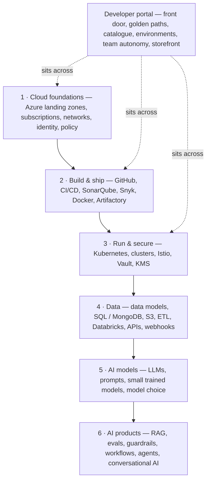
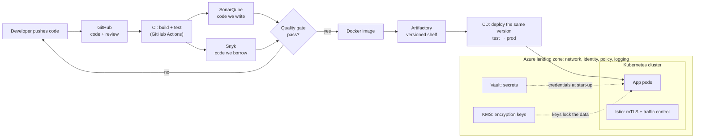
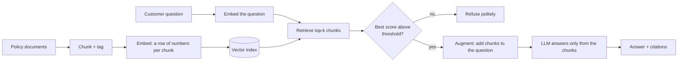
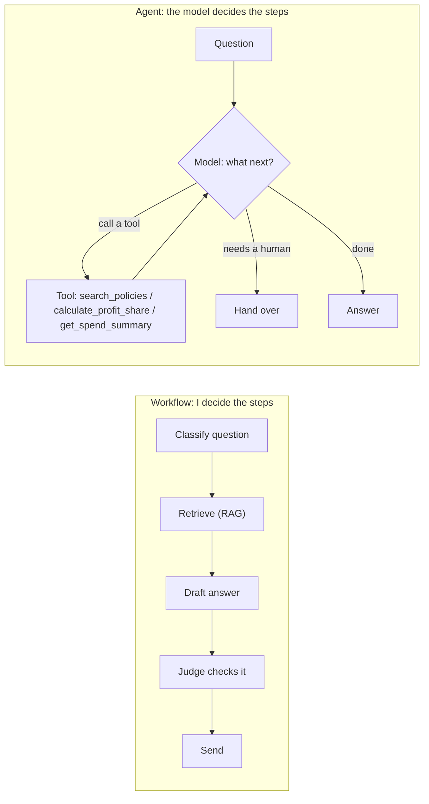
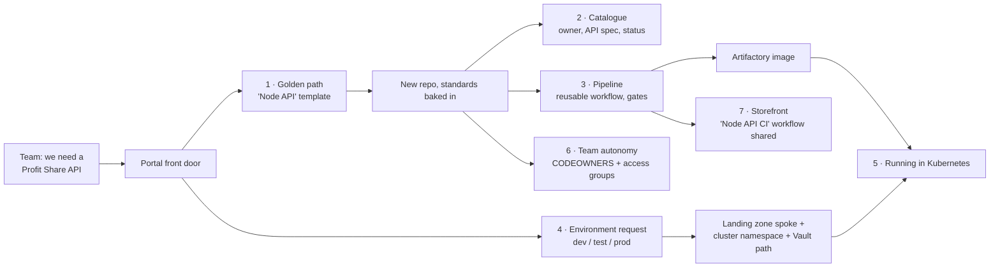
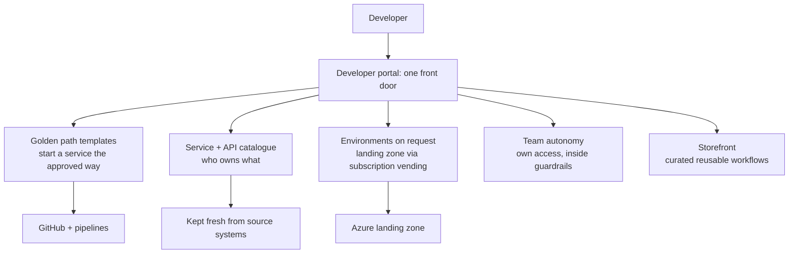
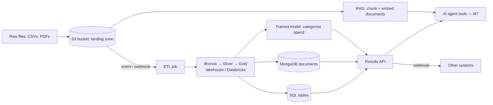

# Sardar Subhpreet Singh Sandhu 2.0 — The Next Chapter

> Built like a Zonda 760: limited run, no longer made, worth more every year.
> Knowledge compounds. So does earning.

**Started:** Friday 16 October 2026
**Old learning:** `BUILD_LOG.md` stays in the folder as the archive (Sessions 01–17). Nothing deleted, nothing active.

---

## The one rule — two levels

Every topic in this file is scored twice:

| Level | The test | Earned |
|---|---|---|
| **Basic** | I can say what it is and why we use it, cold, in plain English, to anyone | In the session itself (the Say step) |
| **Capable** | An engineer asks three follow-ups and I hold my own: **how it works underneath**, **one trade-off** (why this and not the alternative), and **what breaks and how we'd know** | One week later, in the 5-minute **Grill** that replaces the warm-up |

No Bronze/Silver/Gold. No "seeded". Just these two ticks.

**The Grill:** Claude asks me the three follow-ups on the topic I did a week ago, with no notes. Pass all three → Capable ✅. Miss one → it comes back next week.

## Daily accountability — every time I log in

Claude opens every session with the check-in, before anything else:
1. **What did I finish since last time?** Show the commit or the output, not a description.
2. **Today's two sessions:** the platform slot (Track P until 12 Nov, then Track D) — 30 min — and the AI day (30–40 min). Which is done?
3. **Missed a day?** The missed session comes first. No skipping ahead, no new shiny topic.
4. **Score it:** ✅ done · ⚠️ part done · ❌ missed — logged in the accountability log at the bottom.

## The capability map — how everything fits together

Everything I'm learning is one stack. Each layer sits on the one below it. Learn bottom-up; explain top-down.



| Layer | Block | **Basic** — I can say… | **Capable** — I can also… | Where I build it |
|---|---|---|---|---|
| 1 Cloud | Azure landing zone | the pre-approved ground an app lands on, with network, identity, policy and logging already set | explain management groups, platform vs application zones, hub-and-spoke, and subscription vending | P10 |
| 1 Cloud | Identity & access | people and services get only the access they need | explain RBAC, federated access, managed identities, and why "who approved this?" matters in audit | P11 |
| 2 Build | GitHub | where code lives, gets reviewed, and runs its pipelines | explain branch protection, rulesets, reusable workflows, CODEOWNERS | P5, P11 |
| 2 Build | CI vs CD | CI proves a change is safe to merge; CD makes it safe to release | explain delivery vs deployment, why banks keep a release button, rollback | P2, P4 |
| 2 Build | SonarQube / Snyk | Sonar judges the code we write; Snyk judges the code we borrow | explain quality gates, false positives, who owns the bar, shift-left | P6 |
| 2 Build | Docker | packages the app and everything it needs so it runs the same everywhere | explain images vs containers, layers, base images, image scanning | P7 |
| 2 Build | Artifactory | the trusted shelf we deploy from — build once, deploy many | explain versioning, provenance, remote repos for open source, retention | P7 |
| 2 Build | Migration | four CI/CD tools → one, in waves | explain inventory, parallel run, cut-over, decommission, and how to measure it | P3, P4 |
| 3 Run | Kubernetes & clusters | runs many containers and keeps them healthy | explain pods, deployments, services, namespaces, scaling, rolling updates | P16 |
| 3 Run | Istio | governs and encrypts traffic between services | explain mTLS, traffic splitting / canary releases, sidecars, the cost of a mesh | P17 |
| 3 Run | Vault & KMS | Vault hands out secrets; KMS guards the keys that lock data | explain dynamic secrets, rotation, envelope encryption, HSMs | P18 |
| 4 Data | Data model | the things a bank tracks and how they link | explain keys, normalisation, tables vs documents | D1, D2 |
| 4 Data | SQL vs MongoDB | tables for strict money data, documents for flexible records | explain joins vs embedding, schema-on-write vs read, consistency | D2 |
| 4 Data | S3 | cheap, durable storage for files, private by default | explain buckets, keys, prefixes, lifecycle rules, encryption with KMS | D3 |
| 4 Data | ETL | extract, clean, load — and mask personal data on the way | explain ETL vs ELT, batch vs streaming, idempotent re-runs | D4 |
| 4 Data | Databricks / lakehouse | files and tables together, bronze → silver → gold | explain Spark, Delta tables, why a lakehouse vs a warehouse | D5 |
| 4 Data | Results API | how other systems get our data and model results | explain REST, JSON contracts, status codes, async jobs (202 + job ID) | D8, D9 |
| 4 Data | Webhooks | the system tells you when something happens, instead of you asking | explain signed payloads, retries, idempotency, push vs poll | D10 |
| 4 Data | Data trust | quality checks, lineage and privacy | explain data contracts, lineage for audit, PII masking | D11 |
| 5 Models | Trained model | a function learned from examples | explain training vs test data, features, overfitting, drift, retraining | D6, D7 |
| 5 Models | LLM & prompts | a general model steered by its prompt | explain tokens, context window, temperature, non-determinism, prompt as spec | Day 22 |
| 5 Models | Model choice | small vs large is a quality / speed / cost trade-off | explain how I'd prove the cheaper model is good enough, with evals | D7, Day 23 |
| 6 AI products | RAG | fetch the right chunks, answer only from them, cite or refuse | explain chunking, embeddings, top-k, thresholds, hybrid search | M1 |
| 6 AI products | Evals | how we know the AI is good enough to ship | explain golden sets, LLM-as-judge, SME cycles, quality thresholds in CI | M2, Days 9–12 |
| 6 AI products | Guardrails | stop it saying or doing the wrong thing | explain prompt injection, grounding, refusal, human-in-the-loop | M3, Day 28 |
| 6 AI products | Workflow vs agent | a workflow follows my steps; an agent chooses its own | explain tool calling, the agent loop, trajectories, when an agent is worth it | Days 24–27 |
| 6 AI products | Conversational AI | multi-turn chat that knows when to hand over | explain memory/context, escalation design, resolution vs deflection | Days 29–31 |
| 6 AI products | Value & governance | how we prove it works and stays safe | explain north-star metrics, bias monitoring, transparency, model risk | M5, M6 |

### Diagram 1 — From a line of code to a customer

How layers 1–3 hang together. Every tool has one job, and each hands over to the next.



**Say it:** "Code goes through CI and two gates, gets packaged once, stored in Artifactory, and that exact version is deployed into a cluster that lives inside a landing zone, with secrets from Vault and keys in KMS."

### Which level do I need, for which role?

Honest version: AI PM roles at AI-native companies (the Staff level especially) expect **Capable on the whole of layers 5–6** — they will grill me on evals, prompts, agents and trade-offs with ML engineers. They expect **Basic on layers 1–3** and **Capable on the parts of layer 4 that feed AI** (data models, ETL, APIs, ground truth). My current role and DevEx roles need the opposite: **Capable on layers 1–3**, Basic on 4–6.

| Target | Layers 1–3 (cloud, build, run) | Layer 4 (data) | Layers 5–6 (models, AI products) |
|---|---|---|---|
| Current job / DevEx & platform PM | **Capable** | Basic | Basic |
| Bank GenAI PO (e.g. ADCB) | Basic | Capable on D1–D4, D11 | **Capable** |
| Staff AI PM at an AI-native company | Basic | Capable on D6–D10 | **Capable — deeply** |

So the AI track is the one that must reach Capable first. Platform and data get Basic everywhere, then Capable where the target role needs it.

## North Star

GenAI Product Owner for knowledge systems in a regulated bank: RAG, evals, guardrails, governance.
Every module below is one paragraph of that job.

**Widened on 18 Oct 2026:** AI PM roles at AI-native fintech and customer-service AI companies ask for three more things: agents, conversational AI, and the data side of evals (LLM-as-judge, ground truth, feedback loops). Conversations 13–18 and Module M7 cover them.

## Daily routine — 40 minutes, weekdays

| Min | Step |
|---|---|
| 5 | **Warm-up:** say yesterday's sentence out loud, no notes |
| 15 | **Learn:** one concept, taught through my own repo |
| 10 | **Do:** one small real thing (run, test, edit, commit) |
| 5 | **Say:** write the one sentence I'd use with an engineer + the one question I'd ask them |
| 5 | **Words & stories:** a few new words with their roots (Latin / Greek), plus one Sikh sakhi and one Greek myth |

## Build days — 30 minutes (Days 9–12, 22–31, and every Track P session)

Build first. The concept is taught *while* I build, from my own output — never as reading beforehand.

| Min | Step |
|---|---|
| 5 | **Grill:** three Capable follow-ups on last week's topic, no notes (until the first week's done: say yesterday's sentence) |
| 2 | **Predict:** write down what I think will happen before I run anything |
| 13 | **Build:** make or change one small thing in `learning/`, `platform/` or `data/`, run it, read the real output |
| 5 | **Learn from the output:** what did the numbers or answers just teach me? Name the concept |
| 5 | **Say:** one sentence for an engineer + one question I'd ask them. Commit and push |

Words & stories still follow, as before.

## Word bank (use each one in a real sentence this week)

| Date | Word | Root | Means | My sentence |
|---|---|---|---|---|
| 16 Oct | pragmatic | Greek *pragma* — a deed, a thing done | practical, focused on what works | |
| 16 Oct | mitigate | Latin *mitis* (gentle) + *agere* (to do) | to make a risk less severe | |
| 16 Oct | robust | Latin *robur* — oak | strong, hard to break | |
| 16 Oct | articulate | Latin *articulus* — a small joint | to express clearly, joint by joint | |

## Stories told

| Date | Sikh sakhi | Greek myth |
|---|---|---|
| 16 Oct | Bhai Lalo and Malik Bhago — honest earning | Prometheus and Epimetheus — forethought vs afterthought |

---

## The 18 AI engineer conversations (the whole curriculum)

| # | Module | The conversation | Head start from the archive | Basic | Capable |
|---|---|---|---|---|---|
| 1 | M1 RAG | "Walk me through how our RAG pipeline works." | `rag_demo.py` re-run Day 2 ✅; restaurant analogy owned; 8 words in order (chunk, index, retrieve, add, generate, citations, threshold, refuse) — needs saying cold without blanks | ❌ | ❌ |
| 2 | M1 RAG | "How should we chunk and tag our documents?" | Day 2 experiment: `CHUNK_SIZE` 120 → 200 dropped Consumer Duty 0.41 → 0.34, answer got longer and noisier. Three dials learned: size, overlap, tags (filter, cite, restrict). Say step owed | ❌ | ❌ |
| 3 | M1 RAG | "Why did it answer from the wrong passage?" | Real flaw found S17: 0.41 vs 0.18, assess ≠ assessed. Day 2 proved it isn't a chunking problem: the right sentence stays at 0.18 at any box size | ❌ | ❌ |
| 4 | M2 Evals | "How do we know the RAG is actually any good?" | Retrieval vs generation quality introduced S16 | ❌ | ❌ |
| 5 | M2 Evals | "What goes in the eval set, and where does it run?" | `test_retrieval.py` + `vector-check.yml` already green in CI | ❌ | ❌ |
| 6 | M3 Guardrails | "What's prompt injection and how do we stop it?" | One-liner drafted S16 | ❌ | ❌ |
| 7 | M3 Guardrails | "How do we stop it leaking confidential data?" | — | ❌ | ❌ |
| 8 | M3 Guardrails | "When should it refuse to answer?" | 0.12 threshold explained solo (France = 0.00) | ❌ | ❌ |
| 9 | M4 Tools | "LangChain, Azure OpenAI, Pinecone — what are we buying?" | Self-hosted-stack line drafted; vector DB landscape covered S15 | ❌ | ❌ |
| 10 | M4 Trends | "GraphRAG, RLHF, agents — what are they and when do they matter?" | One-liners drafted S16; agent demo needs finding/rebuilding | ❌ | ❌ |
| 11 | M5 Access | "How do we stop someone retrieving a document they shouldn't see?" | — | ❌ | ❌ |
| 12 | M6 Value | "How would you show leadership this is working?" | Real career evidence; governance-by-design line banked S16 | ❌ | ❌ |
| 13 | M2 Evals | "How do you use an LLM to grade answers, and can we trust the judge?" | — (new 18 Oct) | ❌ | ❌ |
| 14 | M2 Evals | "Where does our ground truth come from, and how does the product get better over time?" | `test_retrieval.py` is the seed | ❌ | ❌ |
| 15 | M4 Tools | "How do you write and test a prompt, and how do you choose a model?" | Self-hosted-stack line banked | ❌ | ❌ |
| 16 | M7 Agents | "What's the difference between an AI workflow and an agent — and when would you choose each?" | Old `agentic_workflow_demo.py` (missing — rebuild) | ❌ | ❌ |
| 17 | M7 Agents | "How do we stop an agent doing the wrong thing?" | M3 guardrails thinking | ❌ | ❌ |
| 18 | M7 Conversational | "How does an AI support agent know it has solved the problem, or needs a human?" | Consumer Duty material from M1 | ❌ | ❌ |

Banked sentences from Sessions 01–17 live in the archive, §7. Reuse them; don't rewrite them.

## Module plan (~7.5 weeks, updated 18 Oct)

| Module | Days | Builds |
|---|---|---|
| M1 RAG house view | 1–3 | Conversations 1–3 |
| M2 Evals | 4–8 | 4–5 + a labelled eval set running in CI |
| M2+ Judge & ground truth | 9–12 | 13–14 · `judge_demo.py`, `golden_set.json`, `feedback_log.csv` |
| M3 Guardrails | 13–17 | 6–8 + a prompt-injection test case |
| M4 Tools & trends | 18–21 | 9–10 |
| M4+ Prompts & models | 22–23 | 15 · `prompt_lab.py` |
| M7 Workflows, agents & conversational AI | 24–31 | 16–18 · `workflow_demo.py`, `agent_demo.py`, `support_agent_demo.py` |
| M5 Access & privacy | 32–34 | 11 |
| M6 Running the product | 35–38 | 12 |
| Mock conversation | 39 | All 18, cold, back to back |

### M1 in detail

**Diagram 2 — How RAG works (layer 6)**



- **Day 1** — The pipeline end to end, in engineer words (`rag_demo.py`). → Conversation 1
- **Day 2** — Chunk size, overlap, metadata tags. → Conversation 2
- **Day 3** — Keyword vs semantic retrieval, using my own Consumer Duty flaw (0.41 vs 0.18). → Conversation 3

### M2+ Judge & ground truth — Days 9–12 (30 min each)

**Day 9 — Build an AI marker**
- *Set-up (once):* add my Claude API key as a Codespaces secret (GitHub → Settings → Codespaces → Secrets), so no key ever sits in the code. That's a Track P lesson too.
- *Predict:* which of 5 `rag_demo.py` answers will score lowest?
- *Build:* `learning/judge_demo.py` — sends each question, the retrieved chunks and the answer to Claude with a 1–5 rubric: "Did it answer only from the chunks?" It prints a score and a one-line reason.
- *Learn from the output:* LLM-as-judge — a model grading a model, against a written rubric.
- *Say:* half of Conversation 13.

**Day 10 — Can I trust the marker?**
- *Predict:* will the judge agree with me on all 5?
- *Build:* mark the same 5 answers myself, as the subject-matter expert (SME). Count agreements. Plant one deliberately wrong answer — does the judge catch it? Run the judge twice — do the scores move?
- *Learn from the output:* SME eval cycles (humans check the judge), quality thresholds ("ship only if 90% score 4+"), judge bias (judges often favour longer answers).
- *Say:* Conversation 13, cold.

**Day 11 — Write the answer key**
- *Predict:* how many of 10 questions will retrieval get right?
- *Build:* `learning/golden_set.json` — 10 questions, the chunk that should come back, and the right answer, written by me. Extend `test_retrieval.py` to check all 10, push, and watch CI go green or red.
- *Learn from the output:* ground truth, and annotation quality (if two people label the same question differently, the key is wrong, not the model).

**Day 12 — Close the loop**
- *Predict:* which bad answers are retrieval problems, and which are answer problems?
- *Build:* `learning/feedback_log.csv` — question, answer, 👍/👎, reason. Log 6 answers. For each 👎, choose one fix: add it to the golden set, fix the chunk, or change the threshold. Make one fix and re-run.
- *Learn from the output:* the feedback loop — every bad answer becomes a test, so the product gets better over time.
- *Say:* Conversation 14, cold.

### M4+ Prompts & models — Days 22–23 (30 min each)

**Day 22 — Prompt lab**
- *Predict:* which prompt gives the most consistent answers?
- *Build:* `learning/prompt_lab.py` — one question, three system prompts (vague, specific, specific + an example). Run each 3 times and save all 9 answers.
- *Learn from the output:* a prompt is a product spec. The same input can give a different output (non-determinism), which is exactly why evals exist.

**Day 23 — Pick the model**
- *Predict:* is the bigger model worth the extra cost?
- *Build:* run the 10 golden questions through a small model (Haiku) and a larger one (Sonnet). Record judge score, seconds taken and cost in a 2-row table.
- *Learn from the output:* the quality / speed / cost trade-off, and prototyping cheaply before committing to a full build.
- *Say:* Conversation 15, cold.

### M7 Workflows, agents & conversational AI — Days 24–31 (30 min each)

I build both with Claude, line by line: first a **workflow** (I decide the steps), then an **agent** (the model decides the steps). Same Bank of Sandhu customer question, so I can compare them side by side.

**Diagram 3 — Workflow vs agent**



Workflow = predictable, cheap, easy to test. Agent = flexible, slower, harder to test. Guardrails: step limit, tool allowlist, human approval for anything that moves money.


**Day 24 — Build a workflow**
- *Predict:* which step will fail most often?
- *Build:* `learning/workflow_demo.py` — four fixed steps in code: (1) Claude classifies the customer question (savings, payments, complaint), (2) my RAG retrieval fetches the right chunks, (3) Claude drafts the answer, (4) `judge_demo.py` checks it before it goes out. Print each step's output.
- *Learn from the output:* a workflow is a fixed recipe. It's predictable, cheap and easy to test, which is why most production AI in banks is workflows, not agents.

**Day 25 — Break the workflow**
- *Predict:* what happens with a question that fits none of my categories?
- *Build:* send 5 questions, including two off-script ones ("move £50 and tell me my new profit share"). Log where the fixed steps can't cope.
- *Learn from the output:* workflows break when the path can't be known in advance. That is the only good reason to reach for an agent.

**Day 26 — Build an agent from scratch**
- *Predict:* how many steps will it take?
- *Build:* `learning/agent_demo.py` — a loop where Claude can call two tools I write: `search_policies` (my own RAG retrieval) and `calculate_profit_share` (a simple Islamic savings calculation for Bank of Sandhu). Ask a question that needs both, and print every step.
- *Learn from the output:* agent = model + tools + a loop. Run Day 25's off-script questions through it and compare with the workflow: more flexible, but slower, dearer and harder to test.

**Day 27 — Read its mind**
- *Predict:* where will it go wrong?
- *Build:* give it 3 tasks. Read the step log (the trajectory) and find one wasted step or wrong tool choice. Improve one tool description and re-run.
- *Learn from the output:* multi-step reasoning and tool orchestration, plus judging the path, not just the final answer.
- *Say:* Conversation 16, cold.

**Day 28 — Put it on a lead**
- *Predict:* can I trick it into moving money?
- *Build:* add a fake `transfer_funds` tool that only prints a request. Add three guardrails: a step limit (max 5), a tool allowlist, and "needs human approval" on anything that moves money. Then try to trick it.
- *Learn from the output:* agent guardrails, human-in-the-loop, and blast radius (how much damage one wrong step could do).
- *Say:* Conversation 17, cold.

**Day 29 — Make it hold a conversation**
- *Predict:* what breaks if it forgets the last message?
- *Build:* `learning/support_agent_demo.py` — a Bank of Sandhu support chat that keeps the conversation history. Have a 4-turn chat where turn 3 says "what about the other account?". Then switch the history off and watch it break.
- *Learn from the output:* multi-turn context — the model only "remembers" what we send back to it each time.

**Day 30 — Know when to hand over**
- *Predict:* which of 5 scripted chats should go to a human?
- *Build:* add handover rules — low retrieval score, the customer asks for a person, or a complaint or vulnerability signal. Run the 5 chats and mark each handover right or wrong.
- *Learn from the output:* escalation design. In a bank, handing over a vulnerable customer is a success, not a failure.

**Day 31 — Measure resolution**
- *Predict:* what percentage will be truly resolved?
- *Build:* run 10 scripted chats. Have `judge_demo.py` label each one resolved, handed over correctly, or failed. Work out the resolution rate.
- *Learn from the output:* resolution rate is the north-star metric for AI support agents. Deflection (the customer gave up) is not resolution.
- *Say:* Conversation 18, cold.

---

## Track P — Platform Product Owner (my current role)

**What I do, in one breath:** I'm the product owner for developer experience at a major UK financial services organisation. My team runs the front door that gets applications onto the engineering platform, we're moving teams off four CI/CD tools (Buildkite, Azure DevOps, Harness and CloudBees Jenkins) onto GitHub, and we're building an internal developer portal: golden path templates, team autonomy, a service and API catalogue, self-service environments, a curated storefront for reusable workflows, and one front door for all of it.

**Why:** I need to talk about this as fluently as I'll talk about AI — at work this week, and in interviews later.
**When:** every weekday, 30 minutes, same build-day format as above (Warm-up → Predict → Build → Learn → Say). Done before the AI day.
**How:** every session builds a small, real version in `bank-of-sandhu`, under a new `platform/` folder. My repo is the mirror; work is the real thing.
**Rule:** concepts and my own builds only. Nothing from internal pages (rankings, scores, use-case numbers, team names) ever goes on GitHub.

| # | The conversation | Theme | Basic | Capable |
|---|---|---|---|---|
| P1 | "What is the DevEx front door, and who is it for?" | One front door | ❌ | ❌ |
| P2 | "Walk me through onboarding an application onto the platform, end to end." | Onboarding | ❌ | ❌ |
| P3 | "Why move off four CI/CD tools onto GitHub?" | Migration — the why | ❌ | ❌ |
| P4 | "How do you migrate a pipeline without breaking a team's releases?" | Migration — the how | ❌ | ❌ |
| P5 | "What does GitHub give us beyond storing code?" | Reusable workflows | ❌ | ❌ |
| P6 | "SonarQube vs Snyk — and who decides the quality bar?" | Quality gates | ❌ | ❌ |
| P7 | "What is Artifactory, and why centralise artefacts?" | Artefacts | ❌ | ❌ |
| P8 | "What's a golden path template?" | Portal — golden paths | ❌ | ❌ |
| P9 | "What's in the service and API catalogue, and how does it stay true?" | Portal — catalogue | ❌ | ❌ |
| P10 | "How does a developer get an environment without raising a ticket?" | Portal — environments | ❌ | ❌ |
| P11 | "What does team autonomy mean, and where are the guardrails?" | Portal — team autonomy | ❌ | ❌ |
| P12 | "Why a curated storefront before a marketplace?" | Portal — reuse (new) | ❌ | ❌ |
| P13 | "How do we measure developer experience?" | Measurement | ❌ | ❌ |
| P14 | "How do our pipelines reach on-prem safely?" | Runners | ❌ | ❌ |
| P15 | "Where does AI fit in the developer platform?" | Bridge to the AI track | ❌ | ❌ |
| P16 | "What is Kubernetes, and what's in a cluster?" | Run — Kubernetes | ❌ | ❌ |
| P17 | "What does Istio add on top of Kubernetes?" | Run — service mesh | ❌ | ❌ |
| P18 | "How do apps get secrets without storing them? Vault vs KMS?" | Secure — secrets & keys | ❌ | ❌ |

### The worked example — one API service, all the way through the portal

To make every portal capability concrete, Track P follows **one** made-up service from idea to live: the **Profit Share API** for Bank of Sandhu. It answers one question: *"If I save £X for N months in the Islamic savings account, what's my expected profit share?"*

Every P session builds one piece of this. By P18 the whole journey exists in my repo.

**Diagram 5 — The Profit Share API's journey through the portal**



**1 · Golden path template (P8)** — the developer clicks "New Node API" and gets this, in minutes:

```
profit-share-api/
├── src/index.js          # a working "hello" endpoint to start from
├── test/index.test.js    # one passing test
├── openapi.yaml          # the API contract
├── Dockerfile            # how it's packaged
├── .github/workflows/ci.yml   # calls the platform's reusable workflow
├── catalog-info.yaml     # registers it in the catalogue
├── CODEOWNERS            # who approves changes
└── README.md             # how to run it, who owns it
```

The point: security scanning, tests, packaging and ownership are there **before the first line of real code**. The approved way is also the fastest way.

**2 · Service and API catalogue (P9)** — `catalog-info.yaml`:

```yaml
apiVersion: backstage.io/v1alpha1   # the common catalogue format (Port uses its own, same idea)
kind: Component
metadata:
  name: profit-share-api
  description: Expected profit share for Islamic savings
spec:
  type: service
  lifecycle: production
  owner: team-savings
  providesApis: [profit-share-api]
---
kind: API
metadata:
  name: profit-share-api
spec:
  type: openapi
  owner: team-savings
  definition: { $text: ./openapi.yaml }
```

And the contract other teams read before calling it — `openapi.yaml` (short version):

```yaml
paths:
  /profit-share:
    get:
      parameters:
        - { name: amount, in: query, required: true, schema: { type: number } }
        - { name: months, in: query, required: true, schema: { type: integer } }
      responses:
        "200": { description: Expected profit share, e.g. {"amount":1000,"months":12,"expectedProfit":38.50,"rate":"3.85% expected, not guaranteed"} }
        "400": { description: Missing or invalid amount or months }
```

**3 · Pipeline (P5–P7)** — the repo's whole `ci.yml` is three lines, because the platform owns the standard:

```yaml
jobs:
  build:
    uses: bank-of-sandhu/platform/.github/workflows/node-api-ci.yml@v1   # test, Sonar, Snyk, Docker, push to Artifactory
```

**4 · Environment provisioning (P10)** — the request form a developer fills in:

| Field | Example |
|---|---|
| Service | profit-share-api |
| Environment | dev |
| Cloud | Azure |
| Size | small |
| Data classification | internal (no customer data in dev) |
| Cost centre | savings |

What happens next: **automated** — a subscription is vended into the right landing zone (policies inherited: UK regions only, no public IPs, everything tagged), a namespace is created in the dev cluster, and a Vault path is set up for its secrets. **Human step** — prod only, a change approval. **Status** — Requested → Approved → Provisioning → Ready, visible in the portal like a parcel tracker.

**5 · Running it (P16–P18)** — Kubernetes keeps 3 copies running, Istio encrypts calls from the mobile app's backend, and the database password comes from Vault at start-up, never from the repo.

**6 · Team autonomy (P11)** — `CODEOWNERS`:

```
*                 @bank-of-sandhu/team-savings
/openapi.yaml     @bank-of-sandhu/team-savings @bank-of-sandhu/api-guild
```

The team approves its own changes and manages its own access group. The platform still enforces the guardrails: branch protection, required checks, no direct pushes to `main`.

**7 · Storefront (P12)** — once `node-api-ci.yml` is proven, it's listed for other teams:

| Workflow | What it does | Owner | Maturity | Example |
|---|---|---|---|---|
| Node API CI | test, scan, package, publish | platform team | ✅ stable (12 teams) | profit-share-api |

**Say it:** "Take a team that needs a new API. They pick the golden path, get a repo with pipelines, scanning and ownership built in, it appears in the catalogue with its contract, they request an environment that lands in a compliant landing zone, and they own it from there inside our guardrails."

### Track P — session by session (30 min each)

**Diagram 4 — The developer portal: one front door**




**Mon 19 Oct — P1 One front door**
- *Predict:* how many clicks does it take today to reach my pipelines, scans, docs and live app?
- *Build:* `platform/README.md` — one page linking to everything a developer of `bank-of-sandhu` needs. Count the clicks again.
- *Learn:* one front door cuts tool-hopping and cognitive load. It's the reason a portal exists, so every other feature must protect it.

**Tue 20 Oct — P2 Onboarding, end to end**
- *Predict:* how many steps did it take to get my repo from empty to deployed?
- *Build:* `platform/onboarding.md` — a Mermaid diagram of my own journey: repo → branch protection → CI → scans → deploy. Pull the real dates from my commit history.
- *Learn:* onboarding is a product; time to first green pipeline is its headline metric (my real story: 14 days → under 2).

**Wed 21 Oct — P3 Migration: the why**
- *Predict:* what are the three biggest costs of running four CI/CD tools?
- *Build:* `platform/migration-inventory.csv` — 8 made-up pipelines with tool, team, complexity and wave.
- *Learn:* why consolidate: licence cost, skills spread four ways, four security models, no single audit trail. Waves go from simple and keen teams first to complex last.

**Thu 22 Oct — P4 Migration: the how**
- *Predict:* which parts of an old pipeline won't translate cleanly?
- *Build:* take a small generic Jenkinsfile and translate it into a GitHub Actions workflow in my repo. Run it green.
- *Learn:* inventory → translate → parallel run → cut over → decommission the old tool. Decommissioning is where the saving actually lands.

**Fri 23 Oct — P5 Beyond storing code**
- *Predict:* how many of my workflows repeat the same steps?
- *Build:* turn one repeated step in `ci.yml` into a reusable workflow (`workflow_call`) and call it.
- *Learn:* reusable workflows are how a platform team ships a standard once and every team gets it.

**Mon 26 Oct — P6 Quality gates**
- *Predict:* would my repo pass a "no High findings" gate today?
- *Build:* read my Snyk and code-scanning results, then add a gate that fails the build on a High (test it on a branch).
- *Learn:* SonarQube checks code quality; Snyk checks the libraries I pull in. The bar is set by risk and security, but owned as a product decision.

**Tue 27 Oct — P7 Artefacts**
- *Predict:* does my deploy rebuild the code, or reuse what CI built?
- *Build:* write a `Dockerfile` for the Node BFF, build the image in Actions and push it to GitHub's container registry with a version tag. Then pull that exact tag in a second job.
- *Learn:* Docker packages the app with everything it needs. Build once, deploy many: Artifactory is the single trusted shelf with versions, provenance and scanning.

**Wed 28 Oct — P8 Golden path templates** *(builds example step 1)*
- *Predict:* how long will it take to start a new service from my repo?
- *Build:* make `bank-of-sandhu` a GitHub template repository, create a new repo from it and time it. List what came baked in.
- *Learn:* a golden path is the approved route made the fastest route — standards by default, not by policing.

**Thu 29 Oct — P9 Service and API catalogue** *(builds example step 2)*
- *Predict:* which catalogue field goes stale first?
- *Build:* `catalog-info.yaml` — name, owner, repo, API link, lifecycle. Make one field wrong on purpose, then work out how it would be caught.
- *Learn:* a catalogue is only trusted if ownership is clear and the data refreshes itself from source systems, not from people remembering.

**Fri 30 Oct — P10 Environment provisioning and landing zones** *(builds example step 4)*
- *Predict:* which steps can be automated, and which still need a human?
- *Build:* (1) `platform/landing-zone.md` — a Mermaid diagram of management groups (Platform, Landing Zones: Corp / Online, Sandbox), a hub network with firewall, and two app spokes. (2) A `workflow_dispatch` "Request an environment" form (cloud, name, size, data classification) that prints the policies the new subscription would inherit and opens a GitHub Issue to track it.
- *Learn:* an Azure landing zone is pre-approved ground with network, identity, policy and logging already set. Subscription vending turns "give me an environment" into self-service: automated where possible, an approval where needed, status you can track like a parcel.

**Mon 2 Nov — P11 Team autonomy** *(builds example step 6)*
- *Predict:* who can merge to `main` today?
- *Build:* add a `CODEOWNERS` file and a ruleset requiring owner review.
- *Learn:* teams own their own services and access, inside guardrails the platform sets (federated access control). Fewer tickets, no loss of control.

**Tue 3 Nov — P12 Storefront before marketplace** *(builds example step 7)*
- *Predict:* what makes someone trust a workflow somebody else wrote?
- *Build:* `platform/storefront.md` — 3 of my reusable workflows, each with a description, an example, an owner and a maturity tag.
- *Learn:* reuse needs curation first: description, owner, maturity. Open it into a marketplace only once ownership and lifecycle rules are clear, or you get duplicates and orphans.

**Wed 4 Nov — P13 Measuring developer experience**
- *Predict:* how often does my repo deploy, and how long from commit to live?
- *Build:* use the `gh` CLI to count runs on `main` and work out my own deploy frequency and lead time.
- *Learn:* DORA metrics (speed and stability) plus onboarding time, adoption and developer satisfaction.

**Thu 5 Nov — P14 Reaching on-prem safely**
- *Predict:* which direction does the connection go — in or out?
- *Build:* a Mermaid diagram of cloud GitHub → self-hosted runner → on-prem target, labelling every connection.
- *Learn:* the runner calls out to GitHub, so no inbound firewall hole is needed. (Owned at Gold in S11; this is the cold re-say.)

**Fri 6 Nov — P15 AI in the platform**
- *Predict:* where does AI already touch my repo?
- *Build:* `platform/ai-in-the-sdlc.md` — three places: coding assistant, PR summaries, and retrieval evals running in CI (`test_retrieval.py`).
- *Learn:* AI is now part of the platform: adoption at scale (my real story: 1,700 engineers), guardrails, and evals as quality gates.

**Mon 9 Nov — P16 Kubernetes and clusters**
- *Predict:* if I delete a running pod, what happens?
- *Build:* in the Codespace, start a tiny local cluster with `kind`, load my Docker image from P7, and write a Deployment (3 replicas) and a Service. Delete a pod and watch it come back. Change the image tag and watch a rolling update.
- *Learn:* the cluster is a pool of machines; Kubernetes keeps the desired state true. Pods, deployments, services, namespaces.

**Tue 10 Nov — P17 Istio service mesh**
- *Predict:* how would I send 10% of users to a new version without a big-bang release?
- *Build:* `platform/service-mesh.md` — a Mermaid diagram of two services with sidecars, mTLS between them, and a 90/10 traffic split. Write the Istio `VirtualService` YAML for the split (reading it is the goal, not running it).
- *Learn:* the mesh encrypts and controls service-to-service traffic, enables canary releases and gives tracing on every call. Trade-off: power vs extra moving parts.

**Wed 11 Nov — P18 Vault and KMS**
- *Predict:* where in my repo could a secret leak today?
- *Build:* run Vault in dev mode in the Codespace, store a fake database password, and read it from a small script at runtime instead of from a file. Turn on GitHub secret scanning and push protection. Write one paragraph in `platform/secrets.md` on how KMS would encrypt my S3 data.
- *Learn:* Vault issues, logs and rotates secrets; KMS guards the keys that encrypt data, and the keys never leave it. Secrets never live in code.

**Thu 12 Nov — Track P mock:** all 18, cold, back to back, at Basic. Capable comes from the weekly Grills.

**My real career stories** (CI/CD platform outcomes, the repayment-journey redesign, the settlement-anomaly AI scoping) live in the archive, §10. Track P and M6 reuse them.

## Track D — Data & building blocks (from Fri 13 Nov)

**Why:** AI products sit on top of data. To talk credibly with data engineers, I need to know how data is modelled, stored, moved, turned into a model and served — and how each piece connects to the next.
**When:** every weekday in the platform slot once Track P finishes (from Fri 13 Nov), 30 minutes, build-day format.
**How:** one small Bank of Sandhu data platform in a new `data/` folder. Everything runs free and locally (SQLite, DuckDB, a fake S3 called `moto`, `mongomock`, scikit-learn, FastAPI). Databricks and MongoDB Atlas free tiers are optional extras.

### How the building blocks connect



Each session adds one box. By D12 the whole picture runs end to end.

| # | The conversation | Building block | Basic | Capable |
|---|---|---|---|---|
| D1 | "How would you model a bank's data?" | Data model | ❌ | ❌ |
| D2 | "SQL or MongoDB — when would you pick each?" | Tables vs documents | ❌ | ❌ |
| D3 | "What's an S3 bucket, and what goes in it?" | Object storage | ❌ | ❌ |
| D4 | "Walk me through an ETL pipeline." | ETL | ❌ | ❌ |
| D5 | "What's Databricks, and what is a lakehouse?" | Lakehouse | ❌ | ❌ |
| D6 | "What is an AI model, really?" | Training a model | ❌ | ❌ |
| D7 | "When would you train a small model instead of calling an LLM?" | Model vs LLM | ❌ | ❌ |
| D8 | "How do other systems get our results?" | REST API | ❌ | ❌ |
| D9 | "What happens when a job is too slow for one API call?" | Async result API | ❌ | ❌ |
| D10 | "What's a webhook, and why not just keep asking?" | Webhooks | ❌ | ❌ |
| D11 | "How do you keep a data pipeline trustworthy in a bank?" | Quality, lineage, privacy | ❌ | ❌ |
| D12 | "Walk me through the whole thing, end to end." | All of it | ❌ | ❌ |

### Track D — session by session (30 min each)

**Fri 13 Nov — D1 Data model**
- *Predict:* how many "things" (entities) does a simple bank need?
- *Build:* `data/model.md` — a Mermaid diagram of Customer, Account, Transaction and Product (Islamic savings, Murabaha), with the keys that link them. Then write one customer as a JSON document.
- *Learn:* entities, relationships, primary and foreign keys — and the same data shaped as tables or as one document.

**Mon 16 Nov — D2 SQL vs MongoDB**
- *Predict:* which query will be simpler in each?
- *Build:* `data/sql_vs_doc.py` — load the same customers into SQLite tables and into MongoDB-style documents (`mongomock`). Ask both for "all transactions for customer 7".
- *Learn:* relational = strict schema, joins, great for money. Document = flexible and nested, fast for one customer's whole record. Most banks use both.

**Tue 17 Nov — D3 S3 buckets**
- *Predict:* is a bucket more like a folder or a database?
- *Build:* with `boto3` and `moto` (a fake S3), create a bucket, upload a messy `transactions_raw.csv` I generate, list it and read it back.
- *Learn:* object storage — buckets, keys and prefixes. The cheap, durable landing zone where raw data and RAG documents arrive. Private by default, always.

**Wed 18 Nov — D4 ETL**
- *Predict:* how many bad rows are in my raw file?
- *Build:* `data/etl_demo.py` — **extract** from the bucket, **transform** (fix dates, drop duplicates, mask card numbers, tag a category from the merchant name), **load** into SQLite. Print rows in vs rows out.
- *Learn:* ETL vs ELT, data quality, and masking personal data before anyone can see it.

**Thu 19 Nov — D5 Lakehouse and Databricks**
- *Predict:* what's the difference between my silver and gold tables?
- *Build:* `data/medallion.py` — the same pipeline as bronze (raw), silver (clean) and gold (monthly spend per customer) using DuckDB. Optional: run it in a Databricks free notebook.
- *Learn:* a lakehouse keeps cheap files and database-style tables together. Databricks runs this at bank scale with Spark. (Same Bronze/Silver/Gold words I used for my learning levels — now they mean data quality layers.)

**Fri 20 Nov — D6 Train an AI model**
- *Predict:* what accuracy will a tiny model get?
- *Build:* `data/train_model.py` — train a scikit-learn classifier to tag transactions (groceries, travel, bills…) from merchant names in silver. Split train/test, print accuracy, save the model file.
- *Learn:* a model is a function learned from examples: training data, features, weights, a test set it has never seen, and overfitting.

**Mon 23 Nov — D7 Small model vs LLM**
- *Predict:* which wins on accuracy, speed and cost?
- *Build:* classify the same 20 test rows with my model and with Claude. Then add a brand-new merchant type and see which copes (drift).
- *Learn:* small models are cheap, fast and predictable; LLMs handle the unexpected. Models drift, so they need versioning and retraining.

**Tue 24 Nov — D8 Results API**
- *Predict:* what should the JSON response look like?
- *Build:* `data/api.py` with FastAPI — `GET /customers/{id}/spend` (reads gold) and `POST /classify` (uses my saved model). Call it with `curl` and open the auto-generated `/docs` page.
- *Learn:* REST endpoints, JSON contracts, status codes, and why an OpenAPI spec is the API's front door (links to the API template in P8).

**Wed 25 Nov — D9 Async result API**
- *Predict:* what does the caller do while the job runs?
- *Build:* `POST /reports` returns `202 Accepted` and a job ID; `GET /reports/{id}` moves from `pending` to `done` with the result.
- *Learn:* long-running jobs, job IDs and polling — the pattern behind most "result" APIs.

**Thu 26 Nov — D10 Webhooks**
- *Predict:* how many wasted calls does polling make?
- *Build:* when a report finishes, my API POSTs to a webhook receiver endpoint. Add a signature check so only my API is trusted. Then look at the real webhooks in my GitHub repo settings.
- *Learn:* push vs pull, signed payloads, retries, and handling the same event twice safely (idempotency).

**Fri 27 Nov — D11 Trustworthy data**
- *Predict:* what's the first thing that will break silently?
- *Build:* add checks to the ETL (row counts, nulls, expected columns) and run them in CI. Write `data/lineage.md`: which table came from which file, and where personal data was masked.
- *Learn:* data contracts, lineage and privacy — what a regulator or auditor will ask for.

**Mon 30 Nov — D12 Connect everything**
- *Predict:* where will the end-to-end run break first?
- *Build:* drop a new file in the bucket → webhook triggers the ETL → bronze/silver/gold → the model tags spend → the API serves it → my M7 agent calls the API as a tool (`get_spend_summary`).
- *Learn:* every block has one job, and the contracts between them (files, tables, APIs, events) are what make the system work.

**Tue 1 Dec — Track D mock:** all 12, cold, back to back.

## What I carry over from the archive

**Habits that work**
- Run the script first, then explain from the real output — never from memory.
- Anything shaky: write it before saying it.
- Embeddings = "a row of numbers for a piece of text". No pixels, no spreadsheets.
- Run demos from the terminal, not the chat panel.
- Idle Codespace? `pip install chromadb scikit-learn pytest` first.
- Check the file name in the tab before explaining anything. Root breadcrumb before "Add file".
- Demos live in `learning/` → run as `python learning/rag_demo.py` from the repo root.
- Predict before you run: write the guess, then compare with the real numbers.
- Undo an experiment: Source Control → hover the file → ↶ Discard Changes (or `git checkout <file>` in the terminal).
- Codespace behind? Click **Sync Changes** before editing anything.

**Watch for**
- Reaching for jargon when tired → stop, say it plainly.
- Jumping to a shiny new topic when a redo feels hard → finish today's one thing.
- Embeddings drifting to "images" → say "text" out loud.
- Tired answers shrinking to single words → that's the stop signal, not a failure.
- Typing commands into the editor instead of the terminal → look for the `$` prompt before typing.
- Mixing up retrieve and augment → retrieve *fetches*, augment *adds* the chunks to the question.
- Calling grounding "the threshold" → not adding pineapple is grounding; refusing the sushi order is the threshold.

**Hours already invested:** 10h 52m tracked (Sessions 13–17) + Sessions 01–12 untracked. LEARNING 2.0: Day 2 = 44m.

## Modules covered so far (Sessions 01–17, archive)

| Old module | What we covered | Status at reset |
|---|---|---|
| M1 GitHub + Actions for non-devs | Cloud vs on-prem split; pipelines reaching on-prem via a self-hosted runner | Stations 1–2 owned (Station 2 at Gold); Stations 3–6 not started |
| M2 Code quality gates | Snyk job found live in `ci.yml`; code scanning on with 3 High findings parked as talking points | Partly seeded → now in Track P |
| M3 Artefact management | — | Not started → now in Track P |
| M4 Platform patterns | Portal, catalogue and golden-path concepts seen | Not started → now in Track P |
| M5 AI in the SDLC | RAG pipeline owned (chunk, retrieve, augment, generate, cite, refuse); built `rag_demo.py`, `vector_demo.py`, `vector_pipeline_real.py`; `test_retrieval.py` running in CI; keyword vs semantic flaw found; evals introduced | In progress → now Modules 1–6 |
| M6 Dashboard + AI overlay (Track C) | — | Not started → parked |
| M7 Agentic infrastructure (Track D) | `agentic_workflow_demo.py` built once (file now missing) | Not started → parked |

Full detail, session by session, stays in `BUILD_LOG.md`.

## Parked (not deleted)

Track C dashboard · M1 Stations 3–6 · `chat.js` chunks 2–6.
(Old M2 quality gates, M3 artefacts and M4 platform patterns now live inside Track P, in a lighter form. Old Track D agentic infrastructure returns as M7 on 18 Oct; the letter D is now reused for the data track.)

---

## Daily log

| Day | Date | Module | Sentence I can now say | Question I'd ask an engineer | Done |
|---|---|---|---|---|---|
| 1 | 2026-10-16 | M1 | "First we chunk the documents and index them, once. For each question, retrieval fetches the best-matching chunks, augment adds them to the question, and the LLM answers only from those chunks, with citations — or refuses if the best match scores below the threshold." | "What's our top-k, and what happens when the best match scores low?" | ✅ with word bank. `rag_demo.py` run cleared on Day 2. |
| 2 | 2026-10-17 (Sat) | M1 | *(owed Monday)* | *(owed Monday)* | ⚠️ Warm-up ✅ (8 words in order). Learn ✅ size, overlap, tags. Do ✅ 120 → 200 dropped Consumer Duty 0.41 → 0.34. Say + words & stories owed. |

## Accountability log

| Date | Platform slot | AI day | Grill | Score | Note |
|---|---|---|---|---|---|
| Fri 16 Oct | — | Day 1 | — | ✅ | |
| Sat 17 Oct | — | Day 2 | — | ⚠️ | Say + words & stories owed |

---

*Public file — no employer or colleague names, ever. Run the scrub before every commit.*
