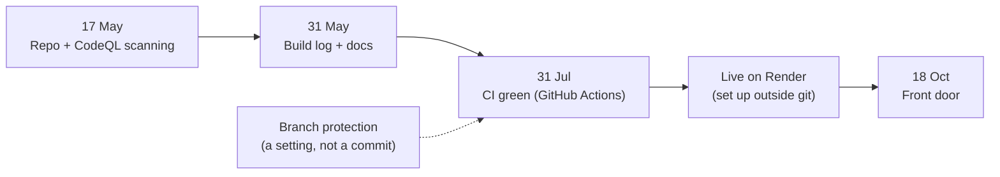

# Onboarding — empty repo to live

How `bank-of-sandhu` actually got onto the platform, from its own git history.

## What I predicted vs what happened

| | Predicted | Real |
|---|---|---|
| Steps | 5 | 5, in a different order |
| Time | 3 days | ~75 days to first green pipeline |

## What it taught me

- **Elapsed time is not effort.** Most of the 75 days was waiting, not work. Onboarding is about removing the waits.
- **Steps outside git are invisible.** Deploy and branch protection left no record, so they can't be measured unless the platform records them.
- **Good defaults set the order.** Scanning came first because it was offered first. That is what a golden path does on purpose.

**Headline metric:** time to first green pipeline.